# NineHA

NineHA è un client Home Assistant nativo pensato per dispositivi fermi a iOS 9.
Il progetto viene compilato con Theos e Clang per ARMv7 ed è stato collaudato
su iPad mini di prima generazione e iPhone 4S. Su entrambi i dispositivi il
Rebuilder e le funzioni principali risultano operativi.

> Stato del progetto: sperimentale. NineHA non è un prodotto ufficiale di Home
> Assistant e non è affiliato a Nabu Casa.

> **Un'alternativa da conoscere:** quando ho iniziato NineHA non conoscevo
> l'esistenza di [HA Dashboard](https://ha-dashboard.github.io/ios-app/).
> Invito chiunque a valutarla come alternativa molto valida, perché è molto
> più compatibile con altre versioni di iOS.

## Screenshot

| Panoramica | Scheda stanza |
|---|---|
| 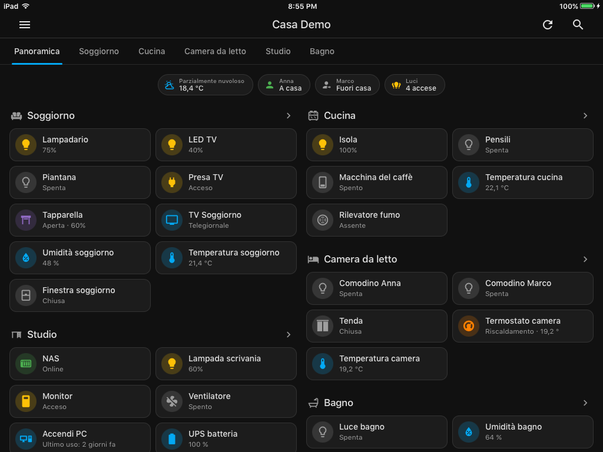 | 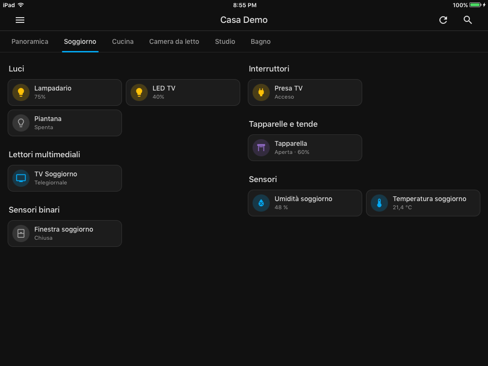 |
| Luminosità | Adattatore NAS |
| 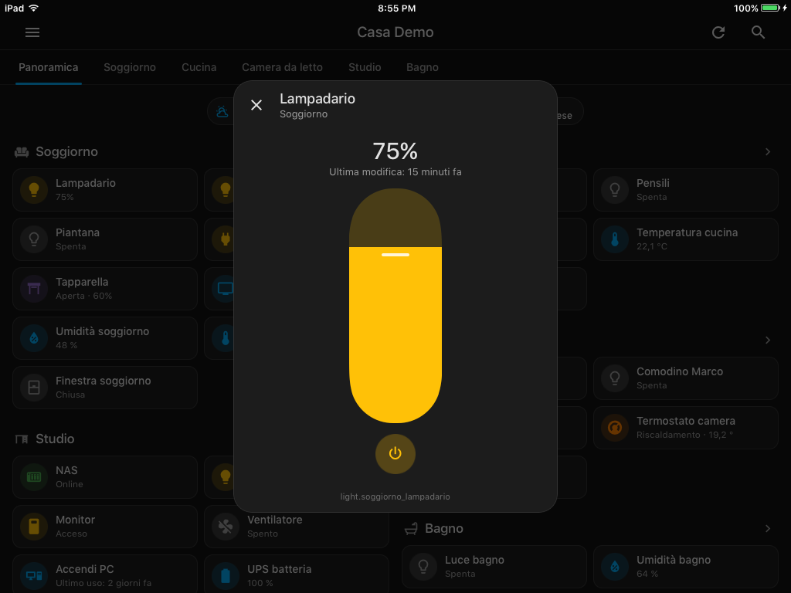 | 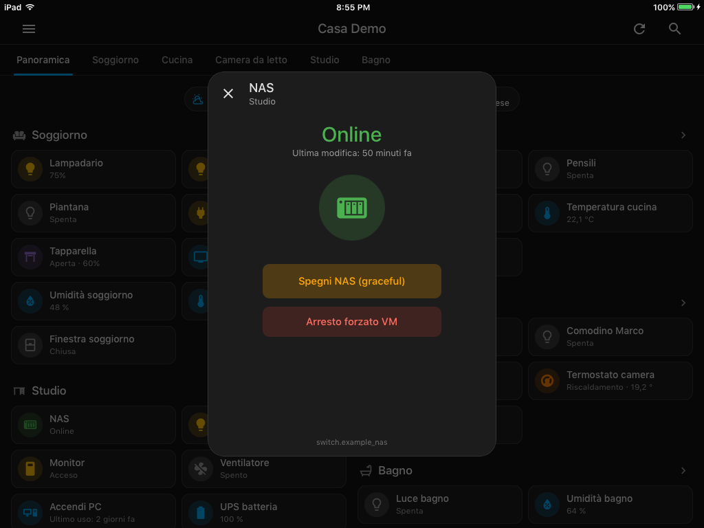 |
| Aspirapolvere | Telecomando TV |
| 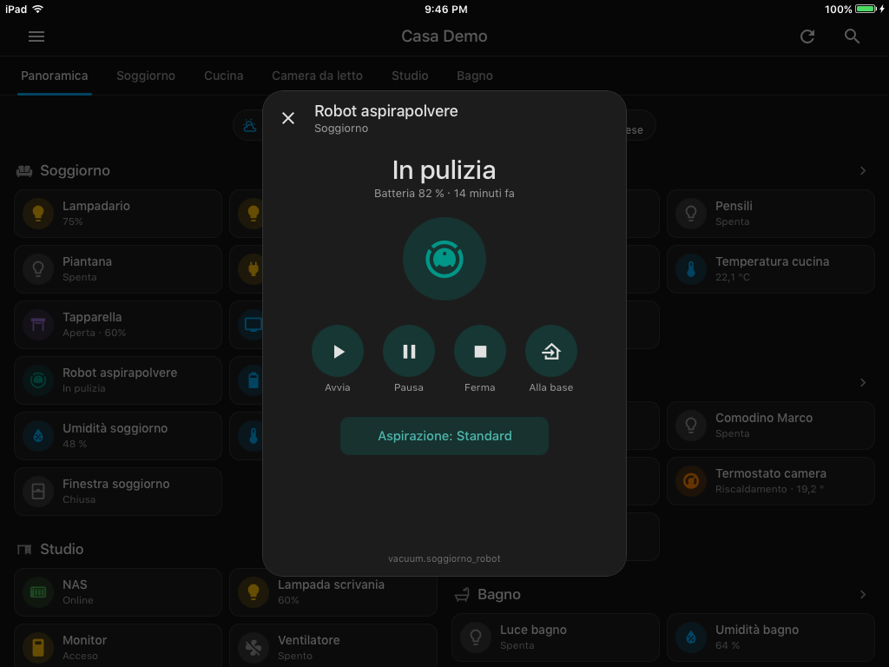 | 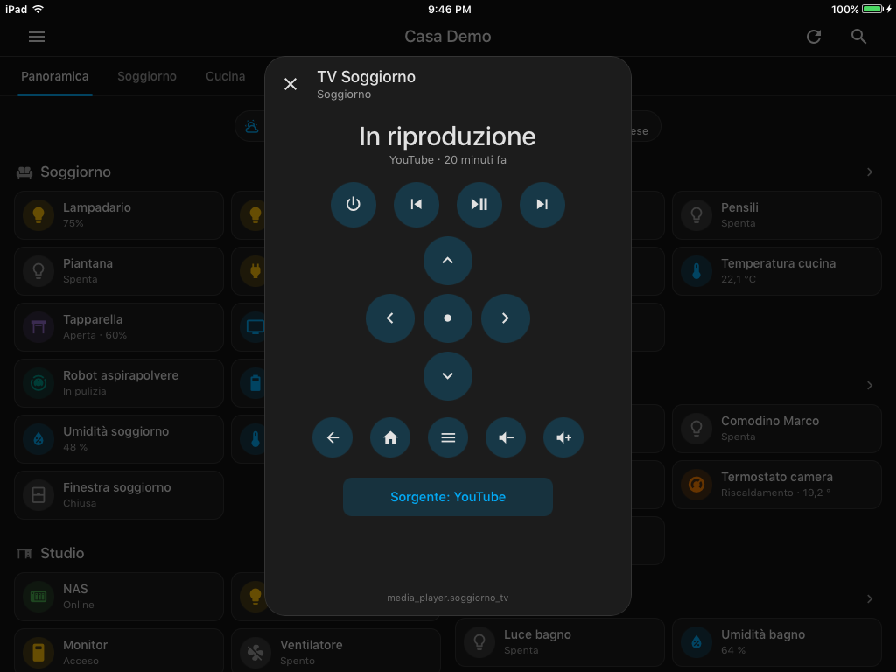 |
| Dashboard personalizzata | Meteo, orologio e griglia valori |
| 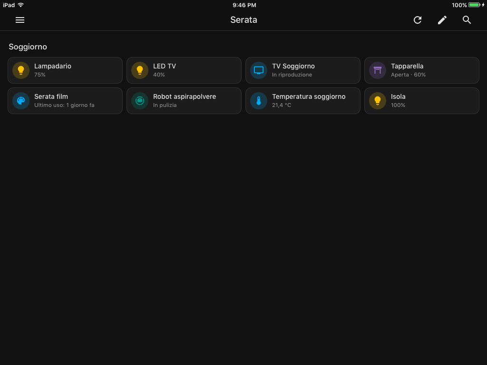 | 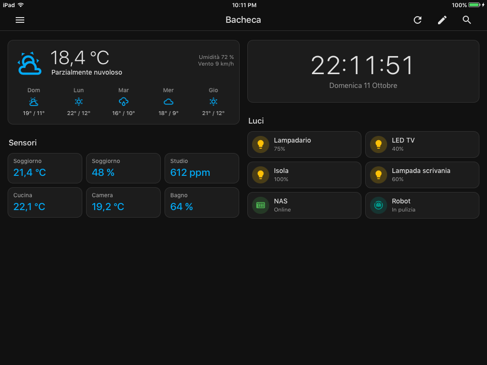 |
| Editor della dashboard | |
| 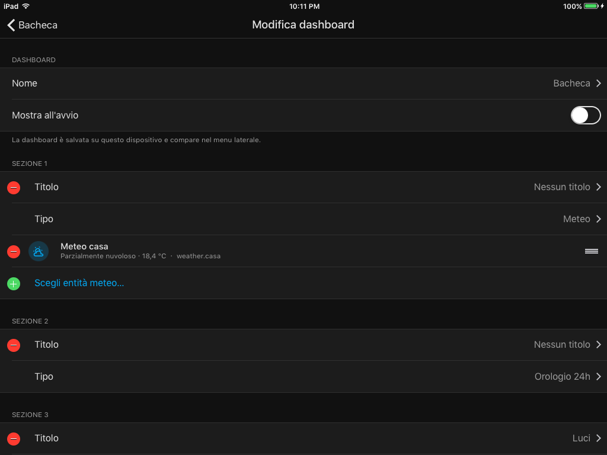 | |
| Termostato | Menu |
| 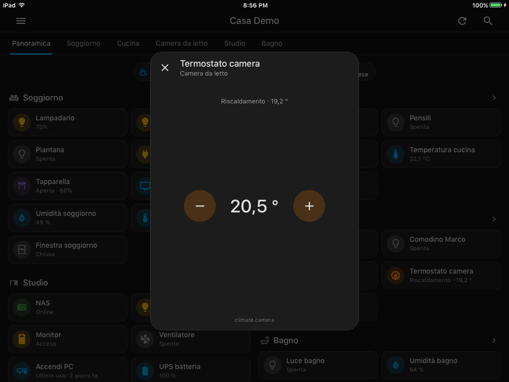 | 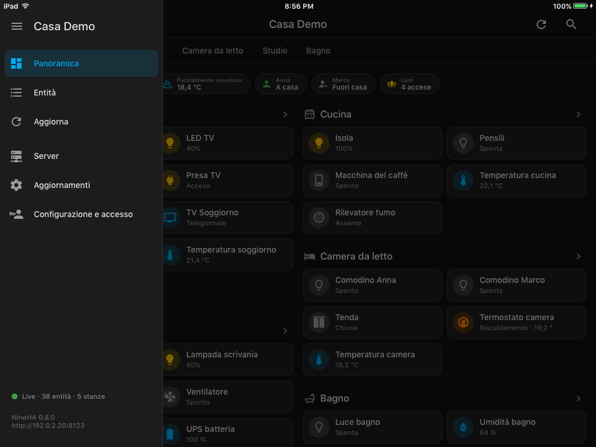 |
| Accesso | Verticale |
| 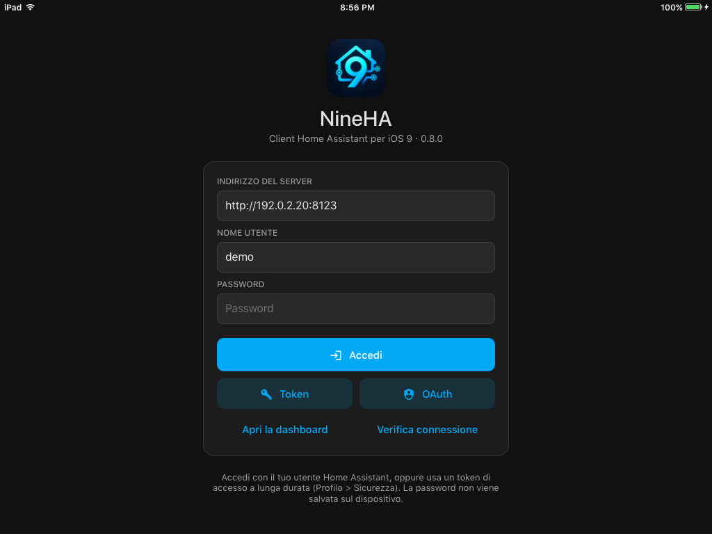 | 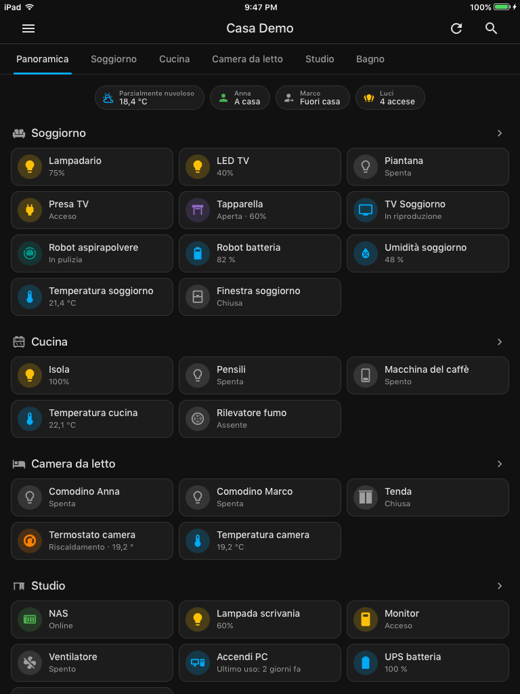 |

Le schermate usano la casa dimostrativa inclusa (`make DEMO=1`) e un
indirizzo riservato alla documentazione: nessun dato reale.

## Funzioni principali

- accesso con nome utente e password (login flow di Home Assistant, con
  verifica in due passaggi), token a lunga durata oppure OAuth;
- dashboard nativa in stile app ufficiale: tema scuro Home Assistant, badge
  (meteo, persone, luci accese), schede per stanza e tile card;
- icone Material Design Icons, le stesse del frontend, incluse le icone
  personalizzate delle entità;
- panoramica per stanza con i comandi e i sensori ambientali, scheda di ogni
  stanza con l'elenco completo raggruppato per tipo;
- pannello dettagli nativo: slider di luminosità, interruttore, tapparelle,
  termostato, lettori multimediali, scene, script e pulsanti;
- controlli per aspirapolvere (avvio, stop, base, velocità) e telecomando
  per Android TV / Fire TV con croce direzionale, home, indietro e volume;
- dashboard personalizzate con sezioni ed entità scelte, gestite dal menu
  laterale e impostabili come schermata iniziale, con sezioni a tile,
  griglia valori, orologio e meteo con previsioni;
- importazione una tantum di una vista Lovelace come dashboard
  personalizzata nativa;
- tocco sull'icona per accendere/spegnere, tocco sul tile per i dettagli,
  pressione prolungata per preferiti e per nascondere entità;
- aggiornamenti live tramite WebSocket, con fallback REST;
- adattatore nativo opzionale per uno switch NAS/VM con stato a più livelli
  (spento, avvio, online, arresto) ricavato da due sensori;
- rotazione automatica portrait/landscape, con tutti gli orientamenti su iPad.

Dalla versione 0.8 il Lovelace Rebuilder e la Lovelace in WebView sono stati
rimossi: la dashboard viene costruita dai registri di stanze ed entità di
Home Assistant, come la panoramica automatica dell'app ufficiale.
Dalla 0.9 una vista Lovelace esistente può essere importata una sola volta
come dashboard personalizzata, senza reintrodurre il motore Lovelace.

## Requisiti

- Linux;
- Theos con toolchain Clang;
- SDK iOS 9.2;
- `ideviceinstaller`/libimobiledevice per l'installazione;
- dispositivo iOS compatibile configurato per eseguire l'app.

## Compilazione

```bash
export THEOS="$HOME/theos"
make clean package FINALPACKAGE=1
```

L'IPA pubblicata nelle release viene compilata con `PUBLIC=1`, che ignora
l'eventuale `Sources/NineLocalConfig.user.h`.

Il pacchetto IPA viene creato nella directory `packages/`.

Per le schermate di documentazione esiste una build dimostrativa senza rete:

```bash
make clean package DEMO=1
```

## Download

La build finale precompilata per ARMv7 è disponibile qui:

- [NineHA 0.9.0 build 50](Releases/NineHA-0.9.0-armv7.ipa)
- [NineHA 0.8.1 build 49](Releases/NineHA-0.8.1-armv7.ipa)
- [NineHA 0.8.0 build 48](Releases/NineHA-0.8.0-armv7.ipa)
- [NineHA 0.7.8 build 47](Releases/NineHA-0.7.8-armv7.ipa) (serie precedente,
  con Lovelace Rebuilder)
- [checksum SHA-256](Releases/SHA256SUMS.txt)

## Installazione

Con il dispositivo collegato:

```bash
ideviceinstaller install NineHA-0.9.0-armv7.ipa
```

Per aggiornare un'installazione già presente si può usare invece
`ideviceinstaller upgrade`. Il nome dell'IPA generata localmente può variare in
base alla versione di Theos.

## Dashboard personalizzate

Le dashboard personalizzate si creano dal menu laterale (Nuova dashboard),
vuote oppure importando una vista Lovelace, e si modificano o eliminano dalla
matita in alto. Sono salvate soltanto sul dispositivo, per ogni server:
l'importazione legge la configurazione Lovelace ma non scrive mai nulla
nell'istanza Home Assistant.

## Accesso con nome utente e password

NineHA usa il [login flow](https://developers.home-assistant.io/docs/auth_api/)
documentato da Home Assistant con il provider `homeassistant`. Nel Keychain
viene salvato soltanto il refresh token: la password non è mai memorizzata.
Nella pagina Profilo > Sicurezza di Home Assistant la sessione compare con il
client `lukelefox.github.io` e può essere revocata in qualsiasi momento.

## Configurazione locale opzionale

La build pubblica non contiene entity ID, servizi o nomi appartenenti a una
specifica installazione Home Assistant. Per abilitare l'adattatore NAS e una
lista esplicita di switch con toggle predefinito:

```bash
cp Sources/NineLocalConfig.user.h.example Sources/NineLocalConfig.user.h
```

Modificare quindi soltanto `Sources/NineLocalConfig.user.h`. Il file è escluso
da Git. Non inserirvi token, password o altre credenziali.

Questa configurazione è necessaria soltanto per l'adattatore NAS: lo switch
indicato viene mostrato con lo stato ricavato dai due sensori e i comandi di
accensione/spegnimento (graceful) e arresto forzato chiedono sempre conferma.
`NINEHA_NAS_TITLE` permette di scegliere il nome mostrato sul tile.

## Privacy e sicurezza

NineHA non include URL di server, token o configurazioni personali. I token
salvati dall'app vengono conservati nel portachiavi di iOS.

Per consentire l'uso con installazioni Home Assistant locali legacy, la build
permette anche connessioni HTTP. Quando possibile usare HTTPS oppure una VPN e
non esporre direttamente Home Assistant su Internet. iOS 9 e i dispositivi
jailbroken non ricevono le protezioni di sicurezza dei sistemi moderni.

Per segnalazioni riservate consultare [SECURITY.md](SECURITY.md).

## Dipendenze

Il repository include SocketRocket nella directory `ThirdParty/SocketRocket` e
il font [Material Design Icons](https://pictogrammers.com/library/mdi/) 7.4.47
in `Resources/MDI`. Le relative licenze sono conservate accanto ai file.

## Licenza

Il codice NineHA è distribuito con licenza MIT. Le dipendenze incluse restano
soggette alle rispettive licenze, conservate nelle rispettive directory
(SocketRocket e Material Design Icons).
